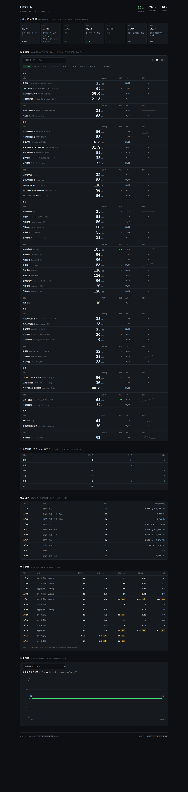
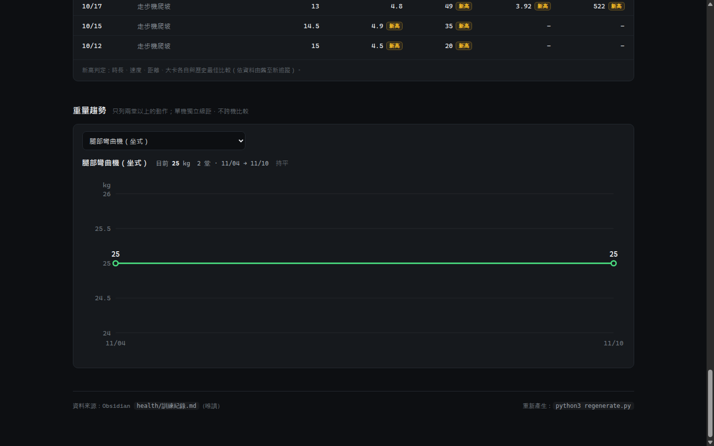

# 訓練紀錄 Dashboard

從 Obsidian 訓練日誌自動產生的深色系靜態 dashboard — 設備總覽、部位組數、重量趨勢、訓練履歷、有氧新高、本週排程一次看完。



## 功能

| 區塊 | 內容 |
|------|------|
| 01 本週排程 vs 實際 | 一週五練排程，已完成／未練／今天／待練／加練一目了然，排程與實練不符會標「錯開／補課」 |
| 02 設備總覽 | 分部位、分單位的表格：**目前工作重量**（最新一次最重組，全頁最大字、等寬數字對齊）、上次日期、增減（`+5` / `—` / `-2.5`，**單位只在欄頭標一次**）、最右欄 40px 微圖；**搜尋＋部位／有增減／本週練過 chips（含台數）**，1px 分隔線取代卡片，一屏可掃 12–16 列 |
| 03 分部位組數 | 近 7 天 vs 前 7 天正式組數，數字右對齊、增減純文字 |
| 04 最近訓練 | 最近 10 堂：日期、部位、組數、**總量分單位**（kg / lbs 絕不合併） |
| 05 有氧紀錄 | 坡度／速度／時間／距離／大卡，刷新個人新高標黃色「新高」小徽章 |
| 06 重量趨勢 | 選一台看完整重量進階折線圖（單機獨立 Y 軸） |

## 資料來源（唯讀）

- `health/訓練紀錄.md` — 部位表格 + 最大重量趨勢 + 有氧
- `health/訓練菜單.md` — 週計畫排程

> ⚠️ 單位混用（lbs/kg 分機器）：總量一律分單位計算，絕不換算合併。
> 組欄格式 `65*20`、`65*4+55*4`（drop set 同組）、`自重`、`40秒`、空值皆有涵蓋。

## 技術

- **單一靜態 HTML**：CSS 與 JS 全部內聯，**零 CDN、零框架、零 npm、零 build** — 不載入任何外部字體或圖庫，字型使用系統字體棧，雙擊 `index.html` 即可離線開啟，也能直接丟上 GitHub Pages。
- **響應式**：桌機、平板、手機皆可瀏覽；窄螢幕時表格改為水平捲動、微圖欄自動隱藏，名稱與當前重量不捲動就看得到，不會整頁被裁切。
- **單一 accent 配色**：近黑底＋灰階為主，綠色只給進步／完成／當前值，黃色只給破紀錄，顏色對應狀態而非裝飾。
- **資料入口唯一**：`regenerate.py` 只替換 `template.html` 裡的 `__DASHBOARD_DATA__` 這一個 placeholder，其餘版面全由模板負責。

## 重新產生

```bash
python3 regenerate.py
```

輸出：

- `index.html` — 靜態 dashboard，**資料已內嵌**，直接雙擊或任意 static server 開啟皆可
- `data.json` — 結構化資料（給其他工具二次使用）

## 專案結構

```
regenerate.py   # 讀 md → 解析 → 聚合 → 產出 data.json + index.html
template.html   # dashboard 模板（CSS + 原生 JS，零框架零 build）
index.html      # 產出：靜態頁（內嵌資料）
data.json       # 產出：結構化資料
docs/           # README 截圖
```

## 截圖


